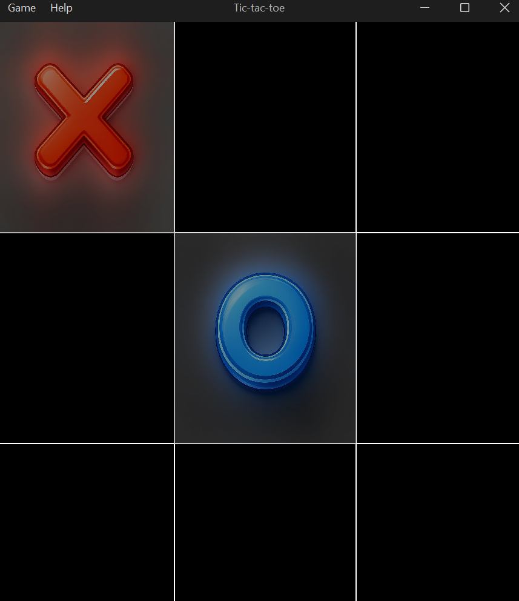

# Tres en raya (Tic-Tac-Toe)

Versión de escritorio del clásico juego de tres en raya hecha con Java Swing, con un oponente **imbatible** basado en el algoritmo Minimax.

## Características

- **Interfaz oscura moderna** con FlatLaf (FlatMacDarkLaf).
- **IA imbatible**: usa Minimax; lo mejor que puede conseguir el jugador es un empate.
- Símbolos X y O con gráficos propios y transparencia.
- Ventana redimensionable: el tablero se adapta al tamaño.
- Menú con *Nuevo juego*, *Salir* y *Acerca de*.
- Avisos claros de victoria o empate; la tecla Esc cierra los diálogos.

## Requisitos

- JDK 21 y Maven 3.9 o superior.

## Compilar y ejecutar

```bash
mvn clean package
java -jar target/mvn-tic-tac-toe-1.0.0-launcher.jar

# o directamente con Maven
mvn compile exec:java
```



## Reglas

1. El jugador **X** (tú) empieza siempre.
2. La **O** (la computadora) juega automáticamente después de tu movimiento.
3. Haz clic en una casilla vacía para colocar tu marca.
4. Gana quien consiga tres marcas en línea (horizontal, vertical o diagonal).
5. Si se llenan todas las casillas sin ganador, es un empate.
6. Usa **Game → New Game** para empezar de nuevo.

## Cómo piensa la IA

La IA recorre recursivamente todas las partidas posibles (algoritmo **Minimax**) y elige el movimiento que más le conviene:

- **Victoria:** `10 - profundidad` (prefiere ganar cuanto antes).
- **Derrota:** `profundidad - 10` (retrasa lo más posible la derrota).
- **Empate:** `0`.

Métodos principales: `findBestMove()` evalúa cada jugada posible; `minimax(depth, isMax)` simula el resto de la partida; `getMax()` maximiza la puntuación de la IA y `getMin()` minimiza la del jugador.

Complejidad: en el primer movimiento se exploran como máximo 9! posiciones; la memoria es O(9) por la profundidad de la recursión.

## Estructura

```text
src/main/java/com/juniverse/game/
├── Main.java
├── model/
│   ├── Board.java            # tablero 3x3 y reglas (victoria, empate)
│   ├── MoveStrategy.java     # cómo elige su jugada la computadora
│   └── MinimaxStrategy.java  # estrategia minimax: nunca pierde
├── gui/
│   ├── GameFrame.java        # ventana y dibujo
│   └── AboutDialog.java
└── util/                     # fechas, iconos y mensajes
src/main/resources/icons/ # x.png, o.png y main.png
```

## Pruebas

```bash
mvn test
```

Una de las pruebas juega todas las partidas posibles del humano y comprueba que la computadora no pierde ninguna. Para añadir otra dificultad basta con otra implementación de `MoveStrategy`.

## Notas

- Ideas para el futuro: niveles de dificultad, modo de dos jugadores, marcador y animación de la línea ganadora.

## Licencia

Código de ejemplo de uso libre con fines educativos.
